<p align="center">
  
</p>

<p align="center">
  <a href="https://www.linkedin.com/in/sidnei-rodrigues-733ba31b7/"></a>
  
  
</p>

```ts
const sidnei = {
  antes:    "Designer gráfico",
  agora:    "Desenvolvedor de soluções para pequenos negócios",
  estudando:"Tecnólogo em Ciência de Dados",
  metodo:   "Conhecimento do negócio + desenvolvimento assistido por IA",
  foco:     ["automação", "IA local", "ciência de dados"],
};
```

## ⚡ Projetos

| Projeto | O que é | Status |
|---|---|---|
| **Prontyn** | Atendimento, orçamentos e pedidos para gráficas. Versões para autônomos e oficinas em desenvolvimento | 🟢 em desenvolvimento ativo |
| **Nodus** | Fábrica de software com IA 100% local: já gerou uma API completa a partir de um pedido simples de um leigo. O foco é o melhor resultado com o menor modelo | 🟡 em desenvolvimento |
| **Assistente para Windows** | Assistente de voz leve, sem IA: entende comandos, abre aplicativos, pesquisa na web e roda rotinas personalizadas. Voz nativa do Windows ou voz natural via Piper | 🟢 funcional |
| **PETBATTLE** | Idle de desktop com pet para cuidar, treinar e evoluir, com ranking e batalhas | 🎮 projeto pessoal |

## 🛠️ Ferramentas

<p>
  
  
  
  
  
</p>
